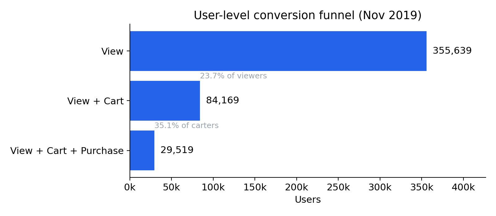
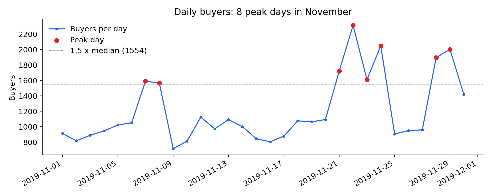
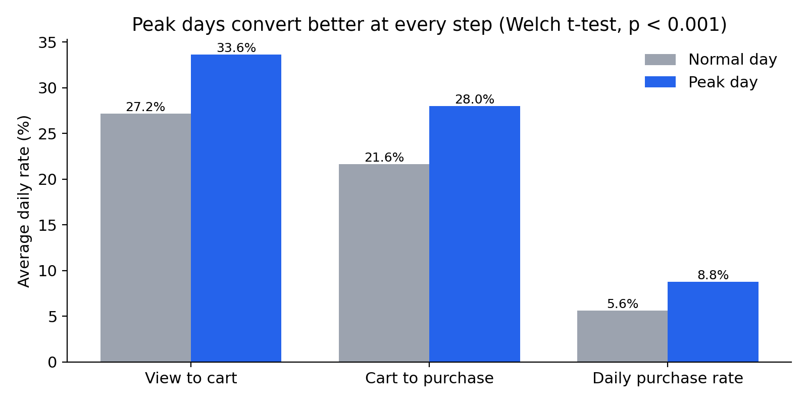
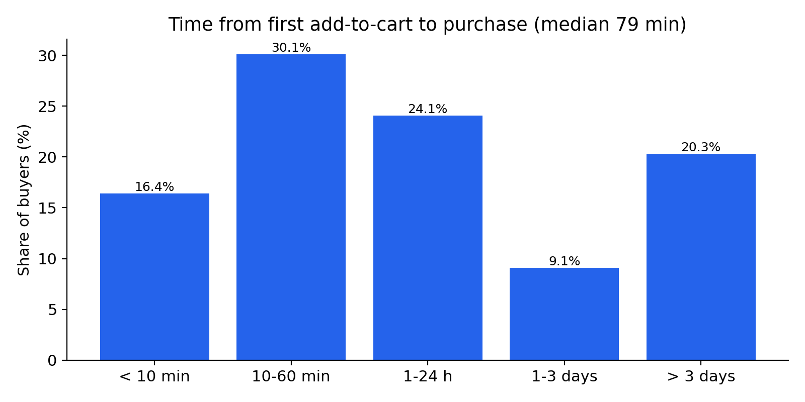
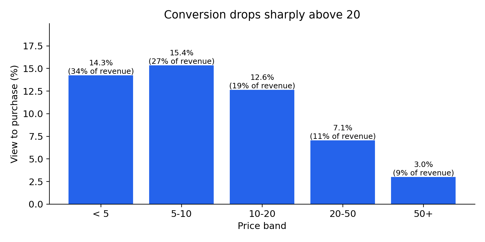
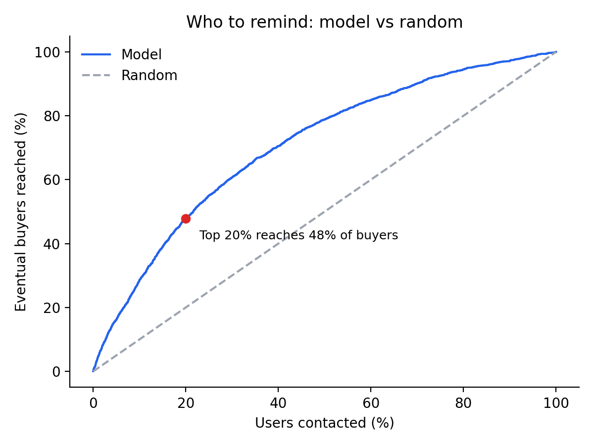

# Cosmetics Shop: Funnel and Cart Abandonment Analysis

This project looks at one month of event logs (November 2019) from an online
cosmetics store. I wanted to find out where users drop off before buying, why
sales spiked on certain days, and which users who abandoned their carts are
worth following up. Most of the work is done in SQL with DuckDB, and I used
Python for the statistical tests, the prediction model and the charts.

## Summary

The biggest loss happens right at the start of the funnel. Only 23.7% of users
who viewed a product went on to add anything to their cart, and once someone
had added to cart, about a third of them ended up buying. The sales peaks in
November were driven mostly by better conversion rather than more visitors:
on the 8 peak days there were about 1.9 times as many buyers per day, but only
about 1.2 times as many active users.

Cart abandonment is also large. Two thirds of users who added something to
their cart never bought it that month. Among those who did buy, the median gap
between the first add-to-cart and the purchase was 79 minutes, and around 70%
bought within a day. For users who still had not bought after 24 hours, a
logistic regression model could rank who was most likely to come back:
contacting only the top 20% would reach almost half of the users who
eventually bought.

## Data and cleaning

The data comes from the "eCommerce Events History in Cosmetics Shop" dataset on
Kaggle, and I used the November 2019 file. Each row is a single user action:
viewing a product, adding it to the cart, removing it from the cart, or buying
it. The raw file has 4,635,837 rows. It is not included in this repository
because of its size.

Cleaning removed 247,464 rows in total. Most of these were exact duplicates
(246,693), and 91% of the duplicates were remove-from-cart events, which had
been making cart removals look far more common than they really were. I also
removed 813 rows with no session ID and 17 rows with negative prices, all of
which were purchases. Rows with a price of zero were kept for the funnel, since
the actions themselves are real, but excluded from revenue. After cleaning
there were 4,388,373 rows from 368,183 users, and 31,524 of them made a
purchase.

## Definitions

I measured the funnel per user across the whole month rather than per session.
Many people add an item to their cart in one visit and come back to pay in
another, so a session-level funnel makes conversion look much worse than it
is: 2.8% per session compared with 8.3% per user. The funnel is strict, meaning
a user only counts at a step if they also completed every earlier step.

The dataset has no order ID, so I treated all purchases by the same user in the
same session as one order. A peak day is defined as any day on which the number
of buyers was more than 1.5 times the monthly median of 1,036. This rule picked
out Nov 7, 8, 21 to 24, 28 and 29, without relying on a holiday calendar.

## Funnel



Out of 355,639 users who viewed a product, 84,169 also added something to their
cart, and 29,519 of those went on to buy. Around 76% of viewers left without
adding anything, which makes the product page the most important place to
improve.

## Peak days and normal days





Conversion was higher on peak days at every step. The view-to-cart rate rose
from 27.2% on normal days to 33.6% on peak days (Welch's t-test, p = 0.0003),
and the cart-to-purchase rate rose from 21.6% to 28.0% (p = 0.0007). Splitting
the growth in buyers into its two parts, about 1.2 times came from more active
users and about 1.6 times from a higher purchase rate.

There is one caveat. Peak days were chosen by the number of buyers, so a higher
purchase rate on those days is partly built into the definition. The
view-to-cart result is the stronger piece of evidence, because cart data played
no part in choosing the peak days.

## Cart abandonment



Of the 95,802 users who added something to their cart, 64,715 never bought it.
About 27,000 of them actively removed items, while the rest simply left their
items in the cart. My first guess was that the second group would be easier to
win back, since they had not given up on anything yet. The model data later
showed the opposite: among users who had not bought within 24 hours, those who
removed something were much more likely to buy in the following week (14.2%
against 5.7%). Editing the cart looks more like careful shopping than giving
up, while users who touch nothing after adding an item have often just left.

The timing data suggests reminders should not be sent straight away, because
almost half of buyers purchase within an hour of adding to cart without any
prompt. A reminder a few hours to a day later seems more useful, and a second
one after about three days could still help, since 20% of buyers took longer
than that to come back.

## Price and products



Conversion falls sharply once prices go above 20, dropping to about 3% for
products priced over 50. Even so, products above 20 still bring in around 20%
of revenue, so they are not worth giving up on.

To make this more concrete, I ranked the 200 most-viewed products by
conversion. The worst performers are mostly priced above 60. Product 5877456,
for example, is the eighth most-viewed product with 3,363 viewers, but only 13
people bought it. A couple of cheap products also converted below 1%, which
price alone cannot explain, so they may have other problems such as misleading
images or stock issues.

## RFM segmentation

Because 88% of buyers purchased only once during the month, splitting
frequency at the median did not separate anyone. I counted two or more orders
as high frequency instead, and split recency and spending at their medians,
which gave eight buyer segments.

Champions, the recent, repeat and high-spending buyers, made up 7.8% of buyers
but 19.4% of revenue. The largest segment by revenue was one-time, high-spending
buyers who had not returned in the second half of the month, accounting for
29% of revenue. With only one month of data, though, low recency really just
means "bought earlier in November", so these segments should be checked against
a longer period before being treated as real churn.

## Predicting who will come back

The model focuses on users who added something to their cart but did not buy
within 24 hours, since most buyers have already purchased by then. It only uses
what happened during those first 24 hours, such as the number of views, carts
and removals and the value of the cart, and it predicts whether the user buys
within the following seven days. I trained it on users whose first cart was
before Nov 15 and tested it on users after that date, so the model never sees
information from the future.

Logistic regression reached an AUC of 0.726 and gradient boosting performed
about the same, so I kept logistic regression because it is easier to explain.
Cart value was by far the most important feature. Users in the top quarter by
cart value bought at 14.6% over the next week, compared with 5.0% in the bottom
quarter. Users who came back for more sessions within the first day were also
much more likely to buy. This sits alongside the earlier price finding rather
than against it: expensive products put people off at the browsing stage, but
someone who has already put expensive items in their cart is showing stronger
intent.



In practice, the model would be used to rank cart abandoners and decide who
gets a reminder. Contacting only the top 20% by score would reach 47.8% of the
users who eventually bought, compared with 20% if the same number of users were
picked at random. Contacting the top 10% would reach 28.5%, with a purchase
rate of 24.5% in that group.

There is an important limit to this. The model predicts who is likely to buy,
not who will buy because of a reminder. Some of the top-ranked users would have
bought anyway, and sending them a coupon would just cost money. Measuring the
real effect of a reminder would need an A/B test, where a random half of the
targeted users get a reminder and the other half do not.

## Recommendations

Since most users leave at the product page, improving that page should come
first, starting with the popular products that convert poorly. Cart reminders
are better sent a few hours to a day after the first add-to-cart, and the model
can be used to decide who receives them, ideally tested against a control group
before rolling out. During promotions, the data suggests that budget spent on
helping people decide, such as cart coupons and limited-time prices, matters
more than budget spent only on attracting more visitors. For expensive
products, samples, bundles or more visible reviews may help lower the barrier
to buying.

## Limitations

This analysis covers only one month, so it cannot show longer-term behaviour
such as repeat purchases over several months. The timestamps are in UTC and the
store's time zone is unknown, so I did not analyse time of day. About 98% of
category names are missing, which meant I could only work with category IDs.
Finally, the reasons I give for certain patterns, such as why people leave
items in their cart, are interpretations rather than something the data
proves directly.

## Files and how to run

```
sql/              SQL files, numbered in the order they were run
load.py           loads the CSV into a DuckDB database (run once)
run.py            runs a .sql file and prints the results
analysis.py       t-tests for peak vs normal days
charts.py         creates charts 1 to 5 in charts/
model.py          purchase prediction model
model_explain.py  feature importance, targeting table and gains chart
```

To reproduce the results, download `2019-Nov.csv` from Kaggle into the project
folder and install the packages with
`pip install duckdb pandas scipy scikit-learn matplotlib`. Then run `load.py`
once, run all the SQL files with `python run.py`, and finally run
`analysis.py`, `charts.py`, `model.py` and `model_explain.py`.